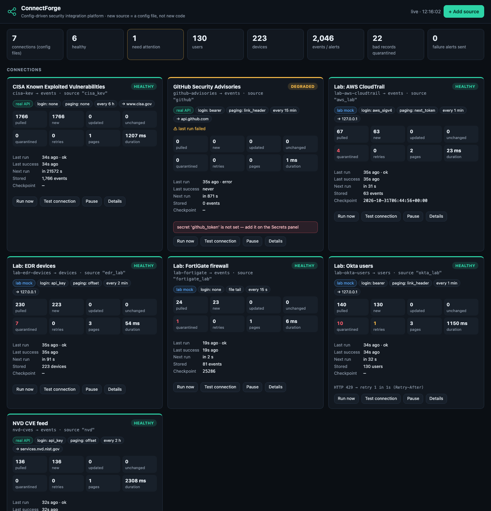

# ConnectForge: config-driven security integration platform

**CyberForge 2026, Problem 05.** In ConnectForge, connecting a new data source (a firewall, a login system, a cloud console) means writing a config file, not new code. The platform does the rest the same way for every connector: it stores secrets safely, retries failures, respects rate limits, quarantines bad data and shows the health of every connection.



## Proven with real free-tier APIs (Goal 6, §4)

| Connector (YAML only) | Data → table | Login | Paging |
|---|---|---|---|
| [`connectors/github_advisories.yaml`](connectors/github_advisories.yaml), **GitHub REST API** | security advisories → `events` | Personal access token (Bearer) | Link header (cursor) |
| [`connectors/nvd_cves.yaml`](connectors/nvd_cves.yaml), **NVD CVE API 2.0** | vulnerabilities → `events` | API key in header (optional) | Offset (`startIndex`), incremental by `lastModified` |
| [`connectors/cisa_kev.yaml`](connectors/cisa_kev.yaml), **CISA KEV** | actively exploited CVEs → `events` | None | None |

The three connectors use three login types and three paging styles. All of them were verified live: CISA returned 1,766 records, NVD returned about 140 CVEs from the last 6 hours, and GitHub's mapping was checked against real advisories.

There are also configs ready for **users**. Fill in your account details and set the secret:

* [`examples/okta_users.yaml`](examples/okta_users.yaml): Okta, SSWS token, Link cursor.
* [`examples/jira_users.yaml`](examples/jira_users.yaml): Jira Cloud, Basic email + API token, `startAt`/`maxResults` offset.
* [`examples/abuseipdb_reports.yaml`](examples/abuseipdb_reports.yaml): AbuseIPDB, key header, page number.

**Lab sources** in [`lab/`](lab/) run against a local mock (`connectforge/mock`). They fill the **users** and **devices** tables offline and let you run the PRD's failure drills on demand: 429s, outages, malformed records, a poisoned next-page link, AWS SigV4 and a tailed firewall log.

## Enterprise coverage: 36 vendor configs in [`catalog/`](catalog/)

Every tool on Mitigata's list has a ready config. **No vendor-specific code was added to the platform;** each tool is just a YAML file.

| Category | Tools | How they connect |
|---|---|---|
| SIEM / XDR | Elastic Security, LogRhythm, Cortex XSIAM | API: ApiKey bearer + offsets in the body; bearer + offset; advanced-key hash + `request_data.search_from/to` |
| | ArcSight, Seceon, Gurucul, Log360, Binary Search | Syslog **CEF** |
| EDR | Sophos Intercept X | OAuth2 → **whoami discovery** (region host + `X-Tenant-ID`) → cursor with `has_more` |
| | Trend Vision One, Trellix EDR, Symantec SES | Bearer + `nextLink`; OAuth2 + JSON:API `links.next`; OAuth2 + `next` in the body |
| | Kaspersky EDR, Seqrite XDR | Syslog CEF |
| DLP | Symantec DLP, Netskope, Digital Guardian, Trellix DLP (ePO), Zscaler ZIA | Basic + page in the body; token header + offset; OAuth2 + positional rows; basic; **obfuscated-key session cookie** |
| | Forcepoint DLP, Safetica | Syslog CEF |
| Firewalls | FortiGate (REST), Cisco FMC (**header token** → devices) | API |
| | Check Point, SonicWall, Sophos Firewall, Juniper SRX, WatchGuard | Syslog: CEF, key=value or regex, sharing one receiver and separated by `file.filter` |
| Cloud | AWS Security Hub + GuardDuty, Google SCC, Wiz, Prisma Cloud, Orca, Lacework, CrowdStrike | SigV4 + nested `Filters.UpdatedAt[0]`; **service-account JWT**; OAuth2 `audience` + **GraphQL cursor**; **token exchange** (body or header); `Token` scheme |

**Status:** catalog configs are **templates** written from the vendors' public API documentation. Each one validates, and all of the platform features they use are tested end to end against lab imitations in [`lab/enterprise/`](lab/enterprise/). They have **not** been run against real tenants, so use **Test connection** and **Dry-run preview** on yours first.

### Platform features added for enterprise tools (all config-driven)

| Feature | Config | Used by |
|---|---|---|
| Token-exchange login (token from the body, a header or a cookie, cached and refreshed on 401) | `auth: {type: token_exchange, login: {url, json/form/headers/basic, token_from, token_path}}` | Prisma, Lacework, Cisco FMC, Zscaler |
| Discovery after login (region base URL and tenant headers) | `auth.discover: {url, base_url_path, headers}` with wildcard `allowed_hosts` (`*.central.sophos.com`) | Sophos Central |
| OAuth2 extras | `client_auth: body`, `extra: {audience: …}` | Wiz, Sophos, CrowdStrike, Digital Guardian |
| Google service account | `auth: {type: google_service_account, secret: <JSON key>, scope}` (RS256 JWT) | Google SCC |
| Cortex advanced API keys | `auth: {type: cortex_advanced, key_id, secret}` | Cortex XSIAM/XDR |
| Zscaler key obfuscation | `${zscaler_key:secret}` and `${now_ms}` in the login body | Zscaler ZIA |
| Nested request paths for paging and cursors | `params_in: body`, `token_param: variables.after`, `offset_param: request_data.search_from`, `offset_end_param`, `has_more_path` | Wiz GraphQL, XSIAM, Symantec DLP, Elastic, AWS |
| XML responses (DOCTYPE/ENTITY refused) | `request.response_format: xml` | XML appliance APIs |
| Syslog receiver + CEF parser | `CF_SYSLOG_PORT` (UDP), `file: {format: cef, filter: …}` | Check Point, ArcSight, Kaspersky, Forcepoint, … |

**Security of the new login flows:**
* Login and discovery calls go through the same **egress allowlist** as data calls.
* A discovered host must match `allowed_hosts`.
* Login uses a throw-away HTTP client, and the shared client's cookies are cleared after every response, so **one connector's session can never reach another's**.
* Credentials inside login bodies must be `${secret:…}` references.

## Requirement map

### What a config file can describe

| ID | Requirement | How |
|---|---|---|
| FR-1 | Authentication: API key plus at least one more | `api_key` (header or query), `bearer` (any scheme, e.g. Okta `SSWS`), `basic`, `oauth2_client_credentials` (cached and refreshed on 401, `audience`, credentials in the body), `aws_sigv4` (signatures match botocore byte for byte), `token_exchange` (body, header or cookie), `google_service_account`, `cortex_advanced`. The PRD syntax works as written: `auth: { type: api_key, header: X-API-Key, secret: okta_key }` |
| FR-2 | Endpoints, method, query params | `request: {base_url, path, method, params, headers, body}` |
| FR-3 | Pagination (2+ styles) | `link_header`, `next_url`, `next_token` (query or body), `page_number`, `offset` (with `total_path`, `offset_end_param`), `none`; values can sit at nested body paths (`variables.after`); `has_more_path` stop flag |
| FR-4 | Schedule | `schedule: {every: 15m}` (`30s`, `2h`, …); the built-in scheduler runs each connector independently |
| FR-5 | Mapping to a common schema | `email: profile.login` shorthand, nested paths `a.b[0].c`, `template`, `const`, `map` lookups, `parse_json`, `regex`, date and epoch conversion, type casts |

### What the platform provides to every connector

| ID | Requirement | How |
|---|---|---|
| FR-6 | Secrets stored safely | Fernet-encrypted vault (`data/vault.json`, key kept separately, `data/` gitignored), or `${env:NAME}`. Configs hold only secret names, and literal credentials are rejected at validation. Secrets are write-only in the UI and API. Each connector can read only the secrets its own config names; every read is audited; any secret that appears in an error is redacted. |
| FR-7 | Retries with backoff | Timeouts, network errors and 5xx/429 are retried after **1 s, 2 s, 4 s**, then the run is marked failed. 401/403 fail immediately with "authentication failed — check the secret". |
| FR-8 | Rate limits | A token bucket per connector, plus **`Retry-After`** / `X-Rate-Limit-Reset` honoured on 429 |
| FR-9 | Bad data handling | Each record that fails mapping is quarantined with its exact reason (e.g. `last_login: Invalid isoformat string: 'yesterday'`). The run continues. |
| FR-10 | Health view | Per connection: status (healthy, degraded, failing, paused), last run, records pulled, new, updated, quarantined, retries, duration, next run, checkpoint, last error and retry log |
| FR-11 | One store, common schema | SQLite `users`, `devices` and `events` tables, keyed by `(source, id)` so re-fetches update rows in place. **Every row keeps `source` and `fetched_at`.** JSONL export is at `/api/records/{table}.jsonl`. |

### Bonus

| ID | Feature | How |
|---|---|---|
| B-1 | Incremental sync | `cursor:` stores the newest timestamp per connector and sends it next run (NVD `lastModStartDate`/`lastModEndDate`, CloudTrail `StartTime`); files resume from a byte offset |
| B-2 | Validate config with clear errors | Every config is checked before it runs: unknown fields, missing required mappings, pasted credentials, hosts outside the allowlist, bad durations, YAML errors. Available as **Validate** in the UI and `cli validate`. |
| B-3 | Test connection | **Test connection** button on every card and in the add-source form, plus `cli test`. It makes one authenticated request with no retries and stores nothing. |
| B-4 | Alerts on repeated failure | After 3 failed runs, a Slack/Teams-compatible webhook alert is sent (`alert_webhook` secret or `CF_ALERT_WEBHOOK`), followed by a recovery alert. The circuit backs off meanwhile. All alerts are listed on the **Alerts** tab. |
| B-5 | Add a source through a web form | **+ Add source → Web form**: endpoint, login, paging, schedule and field mapping, with target fields offered from the schema. It **generates the YAML**, then you Validate, Test, Preview and Save. The new source runs without a restart. |

### Common schema (§4)

| Table | Fields (+ `source`, `fetched_at` on every row) |
|---|---|
| `users` | id, name, email, status, last_login (+ title, department, mfa_enabled) |
| `devices` | id, hostname, ip, os, owner, last_seen (+ mac, status) |
| `events` | id, type, severity, timestamp, description (+ user, src_ip, dst_ip, dst_port, action, outcome, cve, product, url, country, score) |

## Run it

```bash
./run.sh                                   # platform + health page on :8100, lab mock on :9100
```

Set your secrets:

```bash
.venv/bin/python -m connectforge.cli set-secret github_token     # prompts, never echoed
.venv/bin/python -m connectforge.cli set-secret nvd_api_key      # optional
```

Other commands:

```bash
.venv/bin/python -m connectforge.cli validate connectors/*.yaml examples/*.yaml lab/*.yaml
.venv/bin/python -m connectforge.cli test github-advisories
.venv/bin/python -m pytest -q                                    # 62 tests, ~1.5 s, no network
```

You can also set secrets on the **Secrets** tab.

## Failure drills (PRD "Testing failures with real APIs")

| Drill | Do this | You'll see |
|---|---|---|
| Wrong or expired key | Set `github_token` to `bad` and click **Run now** | Fails fast: "HTTP 401: authentication failed — check the secret (github_token)", with no retries and no key in the logs |
| Network off mid-run | Turn Wi-Fi off and click **Run now** on NVD | Retries 1 s, 2 s, 4 s, then "network error (ConnectError)". After 3 runs the status is **failing** and an alert is sent. Turn Wi-Fi on and it recovers by itself, with a recovery alert. |
| Calling faster than the limit (429) | Run **Lab: Okta users** (the mock rate-limits every 3rd call) | Retry log: "HTTP 429 → retry 1 in 1s (Retry-After)" |
| Missing fields fed to the mapper | Any lab source | The Quarantined tab shows each bad record and its exact reason. The run stays OK. |
| Outage | `curl -X POST localhost:9100/mock/chaos -H 'content-type: application/json' -d '{"source":"edr","mode":"outage"}'` | 1/2/4 s retries, then failing; alert after 3 runs |
| Stolen-token redirect (INC-05) | Same command with `{"source":"okta","mode":"evil_link"}` | The request to `evil.example` is blocked before sending, so credentials are never sent, and `egress.blocked` appears in the audit log |

## 3-minute demo

1. **Health page.** Three real APIs with three login types and three paging styles all land in one `events` table. Point at the records pulled and the last-run times.
2. **+ Add source → Web form.** Pick the `user` table, set the endpoint and login, map `email ← profile.login`, then **Generate config**, **Validate**, **Test connection**, **Save**. A new card appears in seconds.
3. **Users / Devices / Events tabs.** Different tools land in the same shape, and every row shows `source` and `fetched_at`.
4. **Break it.** Use a wrong key, turn Wi-Fi off, and set a lab outage. Show the 1/2/4 s retries, the **failing** status and the alert, then the recovery.
5. **Secrets tab.** Values are never shown, configs only name them, and access is scoped and audited.

## Layout

```
connectforge/
  spec.py       config language + validation (FR-1..5, B-2)
  mapping.py    field mapping engine (FR-5)
  auth.py       api_key / bearer / basic / OAuth2 / SigV4, ${secret:} and ${env:} refs
  runtime.py    rate limit, retry/backoff, pagination, incremental sync, scheduler, health, alerts, test
  vault.py      encrypted, scoped, audited secrets (FR-6)
  syslog.py     UDP syslog receiver for push-only devices
  store.py      users / devices / events tables + state (FR-11)
  server.py     REST API + health page
  static/       health page, tables, web form (B-5)
  mock/         lab sources with fault injection
connectors/     real free-tier APIs (YAML only)
catalog/        36 enterprise vendor configs (SIEM, EDR, DLP, firewall, cloud)
lab/enterprise/ lab imitations of each enterprise auth/paging pattern
examples/       ready-to-fill configs for Okta, Jira, AbuseIPDB
lab/            mock-backed connectors for failure drills
```

## Disclosure

The runtime uses FastAPI, Uvicorn, httpx, Pydantic, PyYAML and cryptography (Fernet). The tests use pytest, pytest-asyncio and botocore (only to cross-check SigV4 signatures). The live data comes from public free-tier APIs: GitHub, NIST NVD and CISA KEV. Lab data is synthetic and uses RFC 5737 IP addresses and `.example` domains. The code was built with AI coding assistance (Claude Code).
